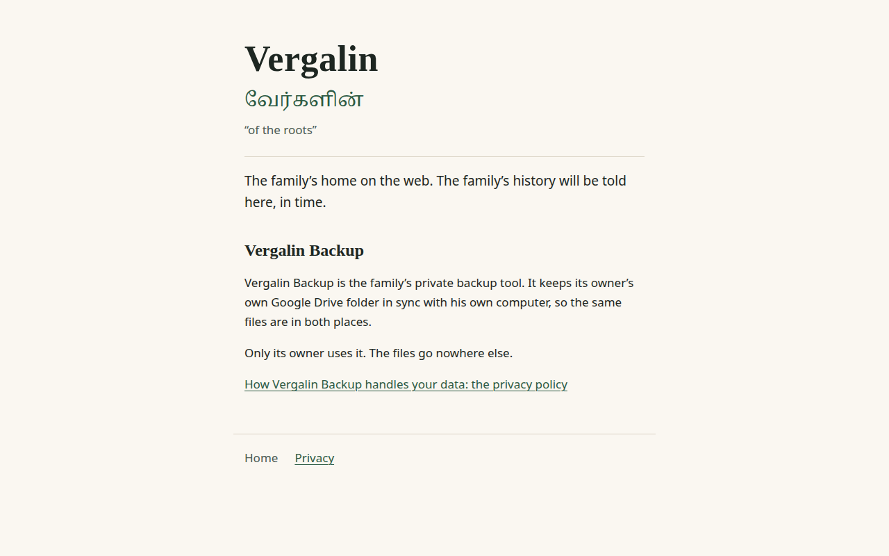
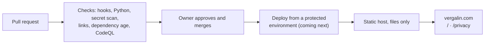

<p align="center">
  <picture>
    <source media="(prefers-color-scheme: dark)" srcset="docs/images/home-dark.png">
    
  </picture>
</p>

# Vergalin

வேர்களின், "of the roots": the family's home on the web, and the privacy policy of Vergalin Backup, the family's
private backup tool. Live at [vergalin.com](https://vergalin.com) from the first deploy.

[](https://github.com/dinesh-ad/vergalin/actions/workflows/ci.yml)
[](https://scorecard.dev/viewer/?uri=github.com/dinesh-ad/vergalin)

## How a change ships



Why the site is files only: [the decision](docs/decisions/2026-11-27-static-site-served-as-assets-only.md).

## Quick start

Node 24 with corepack (`.nvmrc`). The preview serves `public/` with the host's routing, 404 page and headers.

```sh
cd deploy
corepack pnpm install --frozen-lockfile
corepack pnpm run preview   # http://localhost:8787
```

## Links

[Contributing](CONTRIBUTING.md) · [Reporting a vulnerability](SECURITY.md) · [Decisions](docs/decisions/)

## License

All rights reserved: see [LICENSE](LICENSE). A few files copied from other projects keep their own licences, listed in
[REUSE.toml](REUSE.toml).
